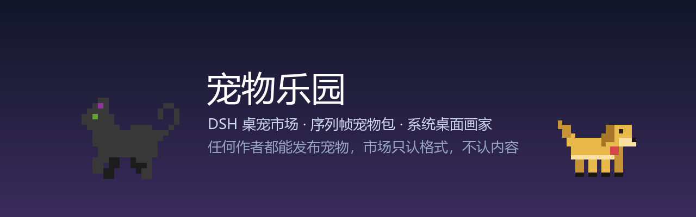
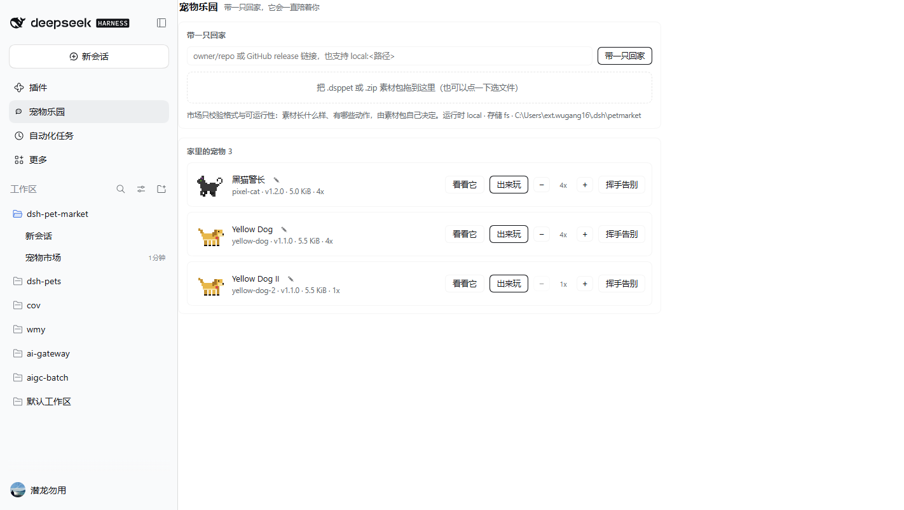
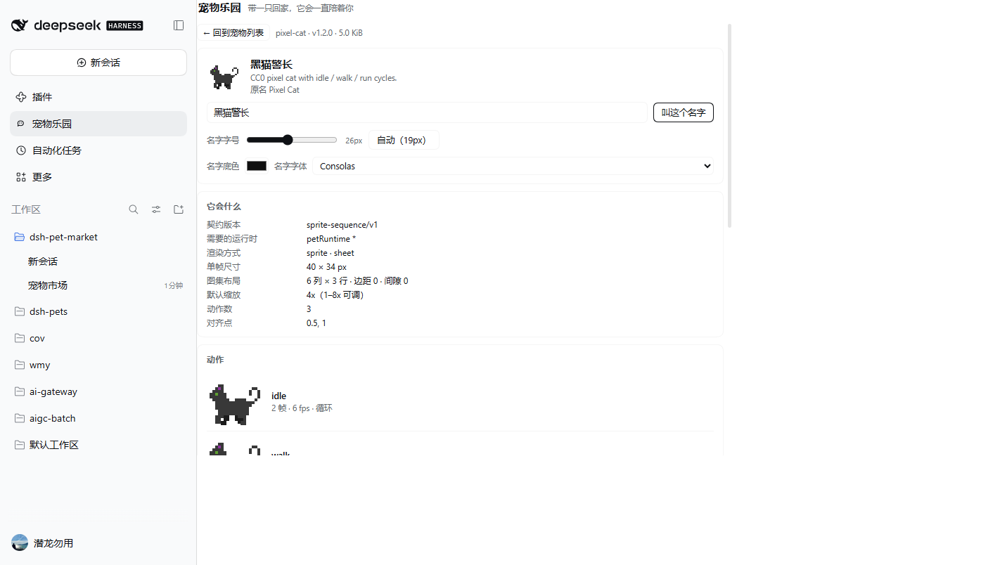
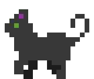
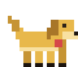
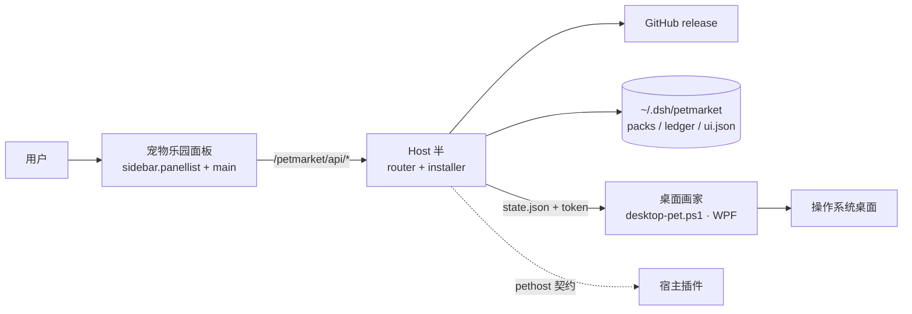

# 宠物乐园 · dsh-pet-market

**DeepSeek Harness 的桌宠乐园**：把一串 GitHub 链接（或者一个现成的 `.dsppet`）粘进面板，序列帧宠物就住到你的 Windows 桌面上——透明置顶、会走会停、能拖动、点一下会撒欢。

    

> **市场是分发管道，不是商店；格式是契约，不是审核。**
> 宠物的长相、动作、脾气都归作者和素材包；市场只回答两个问题：文件合不合规、能不能跑起来。

<p>


</p>

## 它是什么

- **一个 DSH 插件**（Host + Client 两半，零运行时依赖），装上后左侧栏出现「宠物乐园」入口，也出现在 设置 → 宠物乐园。
- **一个序列帧宠物市场**：装的是**素材包**，不是程序。包是纯数据（zip + JSON + PNG/WebP），永不执行包里的 JS。
- **一个系统桌面画家**：宠物画在**真正的 Windows 桌面**上（WPF 透明置顶窗口），不在 DSH 窗口里。DSH 关掉、页面刷新、换标签页，宠物都还在。
- **一套公开的包格式**：[`sprite-sequence/v1`](docs/PACK-FORMAT.md)。作者在自己的仓库发布 `.dsppet`，谁都可以装，不需要经过我们。

## 三分钟上手

一行装好（需要 `pnpm` 在 PATH 里，`npm i -g pnpm` 一行搞定）：

```bash
dsh plugin --profile desktop add github:BBDooooog/dsh-pet-market#v0.1.4
```

然后**完全退出 DSH 再启动**（Host 半只在启动时挂载）。这条命令做完三件事：把插件写进 profile 的 `dependencies`、加进 `dsh.profile.bundles`、装好 `node_modules`。

想跟着 `main` 的最新提交走，去掉 `#v0.1.4`：`dsh plugin --profile desktop add github:BBDooooog/dsh-pet-market`。

改代码调试用 `link:`：

```bash
git clone https://github.com/BBDooooog/dsh-pet-market.git
dsh plugin --profile desktop add link:D:/AI/dsh/dsh-pet-market
dsh plugin --profile desktop install
```

重启后：

1. 左侧栏点「宠物乐园」。
2. 输入 `BBDooooog/dsh-pet-market` —— 它会自己找到最新 release 里的 `.dsppet`，下载、校验、登记。
3. 宠物出现在列表里（**默认在窝里**，不占桌面），点「出来玩」它才上场。
4. 名字旁的 ✎ 可以改名（回车即存）；「看看它」进详情页：契约、动作逐帧预览、右键菜单、事件反应、来源与 sha256。

只想知道后端在不在：`http://127.0.0.1:<port>/petmarket/api/health`，端口每次启动都可能变（看 DSH 窗口地址或启动日志）。

## 四条装宠物的路

| 你手上有什么 | 面板里怎么填 | 走哪条链路 |
| --- | --- | --- |
| 一个 GitHub 仓库 | `owner/repo`、`owner/repo@v1.2.0`、`owner/repo#pet.dsppet` | 解析 release → 挑资产 → 下载 → 校验 digest → 校验格式 |
| 一条 release 直链 | `https://github.com/OWNER/REPO/releases/download/v1.0.0/pet.dsppet` | 不碰 GitHub API，直接下载（未认证 API 限流 60 次/小时时照样能用） |
| 已经下好的包 | 把 `.dsppet` / `.zip` 拖进面板，或点一下选文件 | 本地读取 → 校验 → 登记 |
| 正在开发的目录 | `local:D:/packs/pixel-cat` | 读目录 → 校验 → 登记（作者自测用） |

一个 release 带多只宠物时，用 `owner/repo#pixel-cat-1.2.0.dsppet` 指定装哪一只；给 DSH 配好环境变量 `GITHUB_TOKEN` 后，API 限额从 60 次/小时升到 5000 次/小时（token 只发给 `api.github.com`，资产走预签名链接时不带）。

装进市场 ≠ 上桌面：`带一只回家` 只登记素材，`出来玩` 才画窗口。想回到「装完直接出场」，把 `config.activateOnInstall` 设成 `true`。

## 桌面上的宠物会做什么

- **走路**：待机 3–9 秒，随机朝左或朝右走 1.8–4.2 秒（46 dip/s），撞到屏幕边缘掉头，朝向不对时自动水平镜像（包里的 `renderer.front` 说了算）。
- **点一下**：切到跑动动作，朝一边窜出去 140–230 px，然后回待机。
- **拖动**：按住走哪拖哪，松手记位置（`ui.json`），下次还在那儿。
- **缩放**：面板上 `− 4x +`，以**底边中点**为锚点原地变大变小，1x–8x；不会把别的宠物挤走。
- **右键**：固定一项「回窝睡觉」，下面跟「动作」子菜单（包里没有动作就不出现），样式是圆角的浅色小卡片。
- **名字**：画在头顶，字号默认跟着缩放走；详情页可以调字号、底色、字体，底色深浅会自动决定文字黑白。
- **安全兜底**：置顶每 180 ms 重新断言一次；画家意外退出按 `min(30s, 1.5s × n)` 退避重启；宿主没了画家自己退出（watchdog）；只有一个画家进程能拿到 `stage.lock`。

## 做一个自己的宠物

宠物包就是一个 zip（后缀 `.dsppet`），最少这些文件：

```
pixel-cat/
├── pet.json            # 身份 + 渲染 + 动作 + 状态 + 菜单
├── manifest.json       # 包描述（profile 版本、体积、文件表）
├── market.json         # 商店里给人看的（标签、缩略图、changelog）
├── thumbnail.png       # 列表缩略图
├── animations/cat.png  # 图集：3 行 × 6 列，单帧 40×34
└── checksums.json      # 每个文件的 sha256（不含自己）
```

`pet.json` 的核心长这样：

```json
{
  "schema": 1,
  "id": "pixel-cat",
  "version": "1.2.0",
  "name": "Pixel Cat",
  "engines": { "petRuntime": "^1" },
  "renderer": {
    "type": "sprite",
    "mode": "sheet",
    "image": "animations/cat.png",
    "frame": { "w": 40, "h": 34 },
    "front": "left",
    "animations": {
      "idle": { "row": 0, "frames": 2, "fps": 6, "loop": true },
      "walk": { "row": 1, "frames": 6, "fps": 10, "loop": true },
      "run":  { "row": 2, "frames": 6, "fps": 14, "loop": false, "next": "idle" }
    },
    "states": { "idle": "idle", "walk": "walk", "happy": "run" }
  }
}
```

发布只要三步：仓库里放包源目录 → 打 tag（`v1.2.0`）→ CI 打出 `pixel-cat-1.2.0.dsppet` 附到 release。别人在面板里填 `你的名字/你的仓库` 就能装。完整字段、坐标公式、体积预算、错误码见 **[docs/PACK-FORMAT.md](docs/PACK-FORMAT.md)**。

仓库自带的两个工作流可以直接抄：
- [`.github/workflows/release-packs.yml`](.github/workflows/release-packs.yml)：打 tag 自动打包 + 跑测试 + 上传资产。

## 仓库里有什么

```
dsh-pet-market/
├── index.js              # Host 半入口（cordis 插件：ctx.effect / ctx.provide）
├── client.js             # Client 半：侧栏入口 + 主面板 + 详情页 + 页内舞台
├── lib/
│   ├── router.js         # /petmarket/api/*（同源校验、SSE、台账读写、stage token）
│   ├── install.js        # 作业队列：解析 → 下载 → 校验 → 暂存 → 原子提交 → 注册
│   ├── pack.js           # 包校验器（schema、图集几何、体积预算、错误码）
│   ├── zip.js / hash.js  # 纯 JS zip 读解 + sha256
│   ├── sources.js        # 输入解析（owner/repo、release 链接、local: 路径）
│   ├── github.js         # release 解析、资产挑选、directAsset 免 API 路径
│   ├── download.js       # 流式下载 + digest 比对 + 限流退避
│   ├── ledger.js         # ~/.dsh/petmarket 下的台账与版本目录
│   ├── runtime.js        # 宿主桥：pethost 契约 → 旧 dshpets → local
│   └── desktop-stage-wpf.js  # 系统桌面画家（state.json + token + powershell 进程）
├── stage/                # 画家的前端：desktop-pet.ps1（WPF）、stage.html/js（Electron 分支）
├── demo/                 # 两个演示宠物 + 打包脚本（可复现 sha256）
├── docs/                 # 架构、模块、包格式、来源解析、评审记录
└── test/run.mjs          # 23 项测试（节点原生 test runner，零依赖）
```

## 演示宠物

| 宠物 | 包 | 体积 | sha256 |
| --- | --- | --- | --- |
|  Pixel Cat（黑猫警长） | `pixel-cat-1.2.0.dsppet` | 5886 B | `653fd273f4409cb565dfcae98ed97095a786b9b850859a09055919aa618db202` |
|  Yellow Dog | `yellow-dog-1.1.0.dsppet` | 6200 B | `eaa376de55bcaa7c505e8c50510ce98def97cf8095d5743634b6dddba756a57d` |

猫的素材是 [OpenGameArt 的 Cat sprites（Shepardskin，CC0 1.0）](https://opengameart.org/content/cat-sprites)，重新切成图集并补了 `renderer.front`；黄狗是用 Pillow 画出来的（二十行像素，随仓库授权）。`demo/packs/yellow-dog-2/` 留作多宠共存测试，不发布。

```bash
python demo/tools/build-assets.py      # GIF 帧 → 猫图集（作者侧依赖 Pillow）
python demo/tools/build-dog-assets.py  # 画黄狗图集
node demo/build-demo-pack.mjs          # 猫目录 → .dsppet（自校验）
node demo/build-dog-pack.mjs           # 黄狗目录 → .dsppet
node test/run.mjs                      # 23 项测试
```

打包采用**固定 UTC 时间戳（2020-01-01）+ 不压缩存储**：同样源目录在任何机器、任何 Node 版本、任何时区打出来的 sha256 完全一致（CI 与本机逐字节相同）——release 的 digest、台账、安装时的比对才能串成一条链。

## 架构



三层边界：**core 是纯函数**（校验、解析、哈希），**Host 半是唯一碰网络和磁盘的地方**，**Client 半只走 HTTP + SSE**。想细看：

- [docs/ARCHITECTURE.md](docs/ARCHITECTURE.md) — 目标、非目标、信任边界、三条主流程、状态机、MVP 切分
- [docs/MODULES.md](docs/MODULES.md) — 模块职责、端口接口、Host API 全表、SSE 事件、DSH 插件形态的硬约束
- [docs/PACK-FORMAT.md](docs/PACK-FORMAT.md) — `sprite-sequence/v1` 全部字段与播放语义
- [docs/SOURCES.md](docs/SOURCES.md) — GitHub 输入形态、资产挑选、digest 链、限流与离线
- [docs/REVIEW.md](docs/REVIEW.md) — 决策表与开放选择（含每条推荐）

## 出了状况先看这里

| 症状 | 原因 | 处理 |
| --- | --- | --- |
| 面板一片空白 / 提示「后端未加载」 | Host 半还没挂载，`/petmarket/api/*` 全是 404 | 完全退出 DSH 再启动；`curl .../petmarket/api/health` 应返回 `{"ok":true,...}` |
| 桌面没有宠物，但列表里有 | 它还在窝里（`active=false`），或者画家退出了 | 点「出来玩」；看 `health.desktop.reason`（`running` / `exited` / `storage-degraded`） |
| 宠物被别的窗口盖住 | 对方也是置顶窗口 | 画家每 180 ms 重新置顶；极端情况重启 DSH |
| 走路方向反了 | 素材原生朝向和 `renderer.front` 不一致 | 包里的 `renderer.front` 写 `left` 或 `right`（台账缺字段时画家会直接读包内 `pet.json`） |
| 装 GitHub 链接报 `github-rate-limited` | 未认证 API 每小时 60 次 | 改用 release 直链（走 `directAsset`，不碰 API） |
| 装包报 `digest-mismatch` | 资产被重新上传过 | 让作者重打一次包；本仓的打包脚本已固定时间戳 |

更多排错路径：[README 故障一节](docs/MODULES.md)、[docs/SOURCES.md](docs/SOURCES.md) 的失败表。

## 路线图

- [x] 序列帧包格式 v1 + 校验器 + 体积预算
- [x] GitHub 仓库 / release 直链 / 本地文件 / 本地目录 四条安装路径
- [x] 系统桌面画家（WPF），多宠共存、拖动、缩放锚点、右键菜单、改名
- [x] 详情页：契约、逐帧动作预览、菜单、事件反应、来源校验
- [ ] 包内多宠物（一个 release 带一套 collection）
- [ ] 可选 Ed25519 签名（现在只有哈希链）
- [ ] 目录索引仓库（`dsh-pet-index`）与可搜的发现页
- [ ] macOS / Linux 画家（现在只有 Windows 的 WPF 分支）

## 贡献

- 发现 bug、想要新字段、想加一种渲染 profile：开 issue，附上 `health` 输出与 `<root>/stage/stage.log`。
- 做了一只宠物想被收录：在 issue 里贴仓库链接 + release 链接 + 一张缩略图，我们只核对格式与可运行性。
- 提 PR 前跑 `node test/run.mjs`（23 项，零依赖，秒级）。

## 授权

- 代码：MIT（见 [LICENSE](LICENSE)）。
- 演示素材：`pixel-cat` 来自 OpenGameArt 的 CC0 作品；`yellow-dog` / `yellow-dog-2` 为本仓库原创，随仓库授权。
- 你的宠物：版权归你，授权由你在包里的 `LICENSE.txt` 写清楚——市场不替你决定。

---

**给同路人**：桌宠不该是「每只宠物一个独立程序」。宠物是数据，运行时是平台的，市场是管道。这个仓库就是那条管道的第一个实现。
