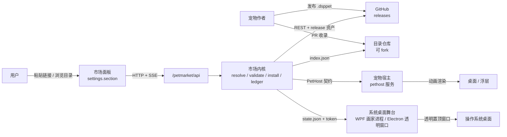
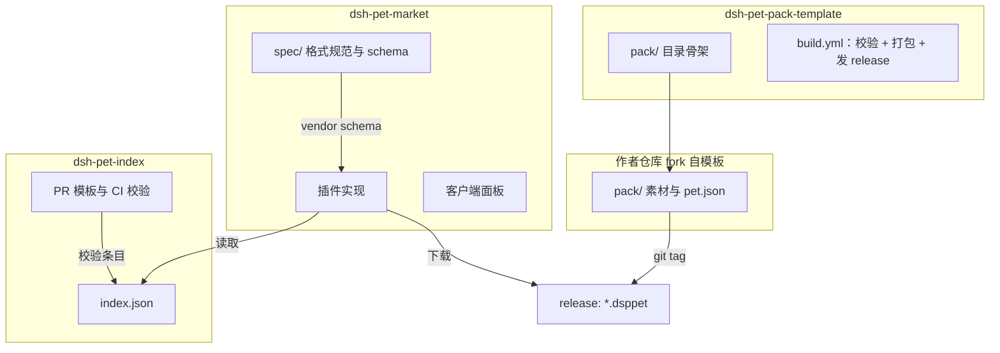
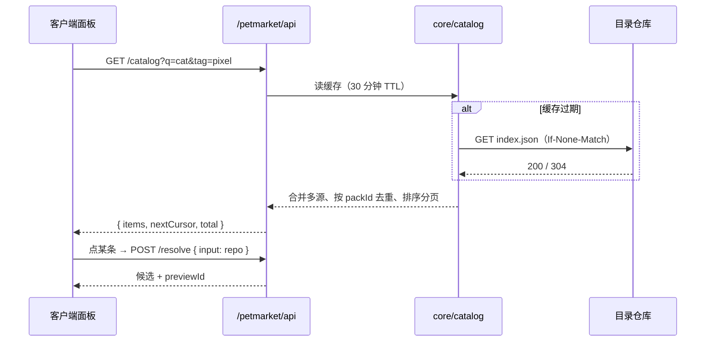
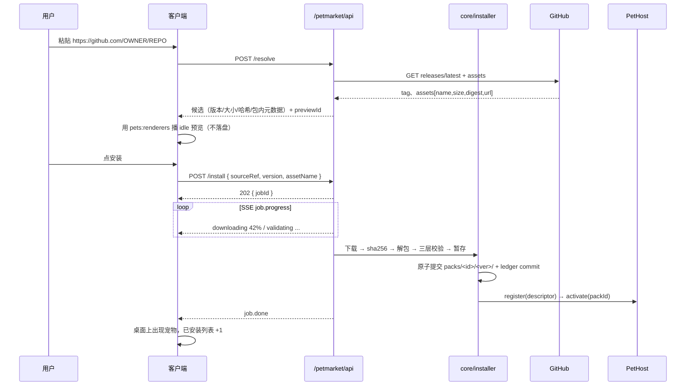
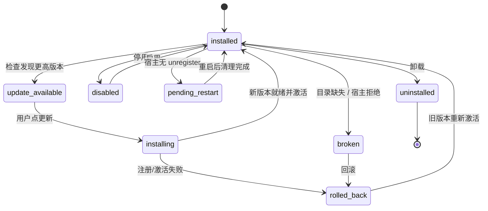

# 架构

市场是 DSH 的一个插件：它把「GitHub 上的宠物素材包」变成「DSH 里跑起来的宠物」，中间只有一条链路——解析、校验、安装、交给宿主。素材内容归作者，运行归宿主，市场只保证这条链路。

格式规范见 [PACK-FORMAT.md](PACK-FORMAT.md)，模块与接口见 [MODULES.md](MODULES.md)，GitHub 解析见 [SOURCES.md](SOURCES.md)，待评审决策见 [REVIEW.md](REVIEW.md)。

## 1. 目标

1. 任意宠物作者在自己仓库发一个 release，就能被市场安装并跑起来，不需要市场方介入。
2. 任意用户粘贴一个 GitHub 链接，就能装上一只宠物；也能从目录里浏览。
3. 安装可校验、可回滚、可离线查看已装列表，失败有明确到字段的原因。
4. 市场本身零后端：无账号、无服务器、无托管、无审核队列。市场仓库开源，目录仓库可 fork。
5. 市场不关心宠物长什么样、有什么动作；只关心包是否合法、是否能在宿主里跑起来。

## 2. 非目标（v1 明确不做）

| 不做 | 原因 |
| --- | --- |
| 内容审核与分级 | 素材与市场无关，市场只做格式合法性判定 |
| 账号、收藏、评论、评分 | 需要后端，与零后端目标冲突；需要时由 GitHub 自身（star、issue）承担 |
| 付费与分成 | 同上，交易在作者自己的渠道完成 |
| 素材托管与 CDN | 资产直连 GitHub release，省带宽也省审计面 |
| 运行时实现与渲染 | 由 PetHost 承担，市场只调用契约 |
| 宠物之间的社交、AI 对话 | 属宿主能力，市场不进入 |
| 脚本化宠物（L3 插件） | v1 只收纯数据包，脚本能力等格式与宿主成熟后再议 |

## 3. 成功指标

| 指标 | 目标 |
| --- | --- |
| 合法包安装成功率（网络正常） | ≥ 98% |
| 首次安装 P50 耗时（≤ 5 MB 包） | ≤ 15 秒 |
| 格式错误可定位率（有 `details.field`） | 100% |
| 目录收录后 24 小时内可安装率 | 100% |
| 更新失败自动回退成功率 | 100% |
| 安装后宿主 `broken` 率 | ≤ 1% |
| 目录包数量（生态指标） | 上线 3 个月 ≥ 30，6 个月 ≥ 100 |

## 4. 系统上下文



四个角色，边界清楚：

| 角色 | 归属 | 对市场的关系 |
| --- | --- | --- |
| 市场插件 | `dsh-pet-market` 仓库 | 本设计对象：UI + 解析 + 校验 + 安装 + 台账 |
| 目录索引 | `dsh-pet-index` 仓库 | 可 fork 的静态 JSON，PR 收录，市场默认预置一个 URL |
| 素材包模板 | `dsh-pet-pack-template` 仓库 | 作者起点：目录骨架 + CI 打包 + 校验 + 发布 |
| 宠物宿主 | 独立仓库/插件 | 按 [PetHost 契约](MODULES.md) 提供 `pethost` 服务 |

## 5. 仓库拓扑与发布节奏



要点：

1. 格式权威在市场仓库 `spec/`；宿主与模板 vendor 同一份 schema，避免多处定义漂移。
2. 目录仓库只做发现：一个 JSON、一个 CI 校验、一个 PR 模板。它挂了不影响「粘贴链接安装」。
3. 模板仓库把「打包」变成一次 `git tag`：CI 校验 `pet.json`、算 `checksums.json`、压 `.dsppet`、发 release。
4. 市场与宿主是两个独立发布节奏，靠 `engines.petRuntime` 与 `schema` 对齐。

## 6. 信任边界

```
┌─────────────────────────── 可信：Host 半 ───────────────────────────┐
│ 市场内核（resolve/verify/validate/install/ledger）                   │
│ 本地数据目录、ledger、config                                        │
└───────────────┬───────────────────────────────┬─────────────────────┘
                │ 只读 HTTPS（域名白名单）        │ PetHost 契约
                ▼                               ▼
        不可信：GitHub 上的任意 release    宿主：只接收已校验的包
                │
                ▼
        不可信：包内一切字节 → 当作数据，按格式解析，从不执行
```

| 面 | 规则 |
| --- | --- |
| 网络 | 只发 HTTPS；域名白名单 `github.com`、`api.github.com`、`objects.githubusercontent.com`、`codeload.github.com`、`raw.githubusercontent.com`；重定向逐跳校验 |
| 包 | 纯数据；扩展名白名单；路径逐条校验；解包落 `tmp/`，校验通过才 `rename` 进 `packs/` |
| 字节 | 三层校验：release digest → `checksums.json` → 结构校验 |
| 浏览器 | 素材只经 `/petmarket/api/packs/...` 与 `/petmarket/api/preview/...`，`Content-Type` 白名单 + `nosniff`；SVG 仅 `` 用途 |
| 写盘 | 全部落在市场数据根下，路径由 `FsPort.resolveInRoot` 收口 |
| 凭证 | GitHub token 只在 Host 半使用，日志与错误里打码 |
| 宿主 | 只接收通过校验的包；市场不向宿主传递未校验路径 |

信任模型一句话：**GitHub 是分发通道，不是信任来源**。任何字节都要自己再算一次哈希。

## 7. 三条主流程

### 7.1 目录发现



目录条目只是「发现信息」，装的时候仍走该仓库的 release，版本与身份以包内 `pet.json` 为准。

### 7.2 链接安装



失败点全部可回滚：下载/校验/校验失败只清 `tmp/`；提交后注册失败保留目录、标 `pending`，点「重试注册」再走一次；激活失败回滚到 `previous`。

### 7.3 更新与回滚



更新不覆盖旧目录：新版本装到 `packs/<id>/<newVersion>/`，旧版本留作 `previous`。回滚不联网、不重算哈希，只切目录再注册。

## 8. 状态模型

市场管理三个互不混淆的状态：

| 状态 | 归属 | 取值 |
| --- | --- | --- |
| 安装状态 | `ledger.records[packId].state` | `installed`、`disabled`、`broken`、`pending-restart` |
| 作业状态 | `jobs[].state` | `queued`、`resolving`、`downloading`、`verifying`、`validating`、`staging`、`committing`、`registering`、`done`、`failed`、`canceled`、`rolling-back` |
| 宿主状态 | PetHost | 由宿主自报，市场只读，用于对账 |

安装状态是持久的，作业状态是瞬时的。作业失败不改安装状态，除非失败发生在「更新」且已提交——那时回滚到 `previous`。

作业进度权重：resolving 5%、downloading 60%（按字节）、verifying 10%、validating 15%、staging 5%、committing 3%、registering 2%。UI 显示当前阶段名 + 百分比，不显示虚构的剩余时间。

## 9. 存储与数据根

```
<dataRoot>/                      # 优先级：ctx.fs 数据目录 → <cwd>/.petmarket → 降级
├── config.json                  # sources、channel、githubTokenRef、ui
├── ledger.json                  # 安装台账
├── packs/<packId>/<version>/    # 解包后的包
├── cache/github/、cache/catalog/、cache/preview/
├── tmp/<jobId>/
└── logs/market.log
```

细节见 [MODULES.md §9](MODULES.md)。降级时元数据走 `ctx.storageDomain`，包仍写本地目录；`/health` 与面板顶部同时标 `storage-degraded`。

## 10. 与宿主解耦

市场对宿主只有一份契约：`pethost` 服务的六个方法与一组行为要求（[MODULES.md §8](MODULES.md)）。由此得到的性质：

1. 换宿主只改 `host/host-bridge`，core 与 client 不动。
2. 宿主的内部实现（DOM、Canvas、原生窗口）对市场不可见，市场也不 import 宿主代码。
3. 宿主能力差异用 `contractVersion()` 与 `engines.petRuntime` 表达，安装前拦下不兼容组合。
4. 市场不做渲染，也不做动画计时；它只保证「包是合法的」与「包被交给了宿主」。

## 11. MVP 阶段

| 阶段 | 范围 | 完成判据 |
| --- | --- | --- |
| M0 骨架 | 数据根、ledger、`/health`、本地目录源（`sourceRef: local:PATH`）安装、PetHost 假实现 | 用本地一个 `.dsppet` 走完整链路，台账正确 |
| M1 链接安装 | GitHub 解析、下载、三层校验、暂存原子提交、SSE 进度、启用/停用/卸载 | 两个不同作者仓库各装一只，桌面出现宠物 |
| M2 目录 | `index.json` 来源、搜索/标签/分页、预览不安装、来源增删 | 目录里点开就能预览并安装 |
| M3 更新回滚 | 频道（stable/prerelease）、pin、同版本内容变化、旧版本保留、回滚 | 升级失败自动回到旧版本 |
| M4 体验 | 面板成品度、i18n、错误引导、离线缓存、模板联动 | 新作者从 fork 模板到目录可见 ≤ 10 分钟 |

不含在 MVP：多实例 UI、脚本宠物、签名与信任等级、自动更新安装。

## 12. 失败模式总表

| 阶段 | 典型失败 | 用户看到 | 系统处理 |
| --- | --- | --- | --- |
| 输入 | 链接不合法 | 可接受形态示例 | `source-invalid`，不产生作业 |
| 解析 | 仓库不存在、无 release、无候选资产 | 具体缺哪一环 | 对应码 + `details` |
| 解析 | 限流 | 重置时间 | `github-rate-limited`，可用 token |
| 下载 | 网络抖动、超时、5xx | 重试按钮 | 3 次退避重试后 `download-failed` |
| 下载 | 资产超限 | 说明上限 | `asset-too-large` |
| 校验 | 哈希不符 | 来源可疑提示 | `digest-mismatch`，删 `tmp/` |
| 校验 | 容器/路径不合法 | 指向打包脚本 | `zip-*`、`path-traversal` |
| 校验 | 字段缺失、图集错位 | 定位到字段/几何 | `schema-invalid`、`sheet-geometry` |
| 校验 | 宿主版本不够 | 所需与现有版本 | `engines-mismatch` |
| 提交 | 磁盘满、权限 | 检查磁盘 | `disk-error`，保留 `tmp/` 供重试 |
| 注册 | 宿主缺席 | 装宿主后重试 | `runtime-unavailable`，目录保留 |
| 注册 | 宿主拒绝 | 宿主原始错误 | `runtime-rejected` |
| 运行 | 目录被外部删、宿主丢注册 | 一键补装 | `broken`，可回滚 |

## 13. 设计取舍

| 取舍 | 选择 | 代价 | 换来 |
| --- | --- | --- | --- |
| 分发 | 直连 GitHub release | 受 GitHub 限流与可用性影响 | 零后端、零托管成本、天然可审计 |
| 发现 | 静态目录 + 任意链接 | 目录需要有人维护 PR | 可 fork、可竞争、无审核瓶颈 |
| 格式 | 序列帧 profile 单一化 | 复杂宠物表达受限 | 校验确定、作者上手快、宿主实现简单 |
| 身份 | `pet.json` 为唯一来源 | 目录条目可能过期 | 装出来的东西与看到的身份一致 |
| 安装 | 暂存 + 原子提交 + 回滚 | 需要一份旧版本磁盘占用 | 失败不脏、可回滚 |
| 审核 | 只做格式，不做内容 | 市场不背书内容 | 中立、可扩展、边界清晰 |
| 宿主 | 只依赖契约 | 宿主能力差异要靠版本卡 | 市场不被单一宿主绑住 |
